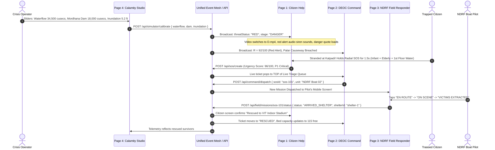

# 🌐 SurakshaSetu: 4 Interconnected Pages & API Endpoint Specification
**System Architecture, Interconnection Protocol, and Complete API Contracts**
*Prepared for the 4-Page Multi-Role Platform Architecture*

---

## 1. High-Level Vision: The 4 Interconnected Roles

SurakshaSetu is structured into **4 distinct, synchronized frontends** operating on a unified crisis event mesh:

```
+---------------------------------------------------------------------------------------------------------+
|                                    UNIFIED CRISIS EVENT BUS / BACKEND                                    |
|             (Real-Time WebSocket / SSE Streams + REST State Controller + Local Fallback Sync)            |
+---------------------+---------------------+----------------------+--------------------------------------+
          ▲                     ▲                      ▲                              ▲
          │ (1) SOS & Evac      │ (2) Triage & Disptch │ (3) Field Missions           │ (4) Calamity Dials
          ▼                     ▼                      ▼                              ▼
+---------------------+ +---------------------+ +----------------------+ +----------------------------------+
| PAGE 1: CITIZEN     | | PAGE 2: DEOC        | | PAGE 3: NDRF &       | | PAGE 4: LIVE CALAMITY            |
| HELP & EVACUATION   | | COMMAND CENTER      | | FIELD PERSONNEL      | | STUDIO & TELEMETRY CONTROL       |
+---------------------+ +---------------------+ +----------------------+ +----------------------------------+
| • Dynamic Video     | • Automated Triage    | • "My Active Missions" | • Real-time Calamity Dials:        |
|   Cover (D/ND/S)    |   Priority Queue      |   GPS & victim tickets |   - Waterflow (cusecs)             |
| • 1.5s Radial SOS   | • 1-Click Rescue Boat | • 1-Tap Field Status:  |   - River Gauge (danger mark)      |
|   Hold Trigger      |   & Unit Dispatch     |   En Route -> On Scene |   - Dam discharge (cusecs)         |
| • Safe Corridor     | • Official Crisis     |   -> Rescued -> Safe   |   - Wind Speed / Cyclone (km/h)    |
|   GIS Navigation    |   Stage Broadcast     | • Field Victim Intake  |   - Inundation depth (ft)          |
| • Live Shelter Beds | • Crowd Road Hazard   |   & Shelter Check-In   |   - Power grid outage toggle       |
| • Offline SMS Kit   |   Verification Queue  | • Hazard verification  | • Live Crisis Injector:            |
| • Family Check-In   | • Bed Allocation      | • Paramedic Supply Log |   Spawns road collapses, downed    |
|                     |                       |                        |   wires, flood spikes across all 3 |
+---------------------+ +---------------------+ +----------------------+ +----------------------------------+
```

---

## 2. Cross-Page Interconnection Life Cycle (How the 4 Pages Talk)

### Scenario: Sudden Upstream Reservoir Release & Flash Flood Surge



---

## 3. Endpoints & API Key Contracts

### 3.1 Base URLs & Protocols
- **REST Base URL:** `http://localhost:5000/api/v1` (or your production API gateway)
- **Real-Time Stream:** `ws://localhost:5000/api/v1/stream` (or SSE: `/api/v1/events/stream`)
- **Headers:** `Content-Type: application/json`, `X-Suraksha-Client-Id: <client-uuid>`

---

### 3.2 Page 4: Calamity Studio & Incident Control Room Endpoints

| Method | Endpoint | Description | Request Payload | Response |
| :--- | :--- | :--- | :--- | :--- |
| `GET` | `/api/simulator/state` | Fetch current simulated hazard parameters | None | `CalamitySimulationControls` |
| `POST` | `/api/simulator/calibrate` | Update live disaster dials (waterflow, wind, dam) | `{ riverDischargeCusecs, riverGaugeMeters, windSpeedKmh, rainfallMmPerHour, inundationDepthFeet, powerGridActive }` | `{ success: true, updatedTelemetry: PalarTelemetry, compositeRisk: RiskFormulaWeights }` |
| `POST` | `/api/simulator/inject-hazard`| Spawn sudden hazard (downed live wire, road breach) | `{ type: HazardType, roadName, waterDepthFeet, location: [lat, lng] }` | `{ success: true, hazardId: string }` |
| `POST` | `/api/simulator/trigger-siren` | Broadcast emergency alert siren across all pages | `{ active: boolean, durationSeconds: number }` | `{ status: "SIREN_BROADCASTING" }` |
| `POST` | `/api/simulator/reset` | Reset telemetry back to baseline normal safe levels | None | `{ success: true, state: "RESET_TO_BASELINE" }` |

#### Payload Schema: `CalamitySimulationControls`
```json
{
  "riverDischargeCusecs": 31500,
  "riverGaugeMeters": 8.4,
  "mordhanaDamDischargeCusecs": 14200,
  "windSpeedKmh": 45,
  "rainfallMmPerHour": 85,
  "inundationDepthFeet": 4.8,
  "powerGridActive": false,
  "sirenActive": true,
  "activeCalamity": "FLOOD"
}
```

---

### 3.3 Page 1: Citizen Help & Evacuation Endpoints

| Method | Endpoint | Description | Request Payload | Response |
| :--- | :--- | :--- | :--- | :--- |
| `GET` | `/api/citizen/overview` | Initial bundle: broadcast stage, telemetry, shelters, hazards | None | `{ stage: "DANGER", telemetry, shelters, hazards }` |
| `POST` | `/api/sos/create` | Submit high-priority rescue distress ticket | `{ citizenName, phone, location: [lat, lng], landmark, trappedCount, hasInfants, hasElderly, hasPregnant, medicalEmergency, medicalDetails, waterLevel }` | `{ success: true, ticketId: string, urgencyScore: number, priorityLevel: "P1_CRITICAL" }` |
| `GET` | `/api/sos/status/:id` | Check live status of my rescue request | None | `{ id, status: "WAITING_DISPATCH" \| "RESCUE_BOAT_DISPATCHED" \| "RESCUED", dispatchedUnit }` |
| `GET` | `/api/routes/safe-evac`| Get current safe routing geometry avoiding inundated bottlenecks | `?fromLat=...&fromLng=...&shelterId=...` | `{ safeRoutePolyline: [lat, lng][], avoidedHazards: HazardIncident[] }` |
| `POST` | `/api/reunion/check-in`| Safe family check-in registry | `{ name, familySize, currentShelterOrLocation, phone }` | `{ checkInId: string, status: "SAVED" }` |
| `POST` | `/api/reunion/report-missing` | File missing person alert | `{ personName, age, gender, lastSeenLocation, clothingDescription, reporterPhone }` | `{ reportId: string, status: "SEARCHING" }` |

---

### 3.4 Page 2: DEOC & Tactical Command Center Endpoints

| Method | Endpoint | Description | Request Payload | Response |
| :--- | :--- | :--- | :--- | :--- |
| `GET` | `/api/command/triage-queue` | Sorted live distress queue (P1 critical first) | None | `{ queue: SOSRequest[], pendingCritical: number }` |
| `POST` | `/api/command/dispatch` | Assign rescue boat or ambulance to SOS ticket | `{ sosId: string, unitName: string, responderId: string, destinationShelterId: string }` | `{ success: true, missionId: string, status: "DISPATCHED" }` |
| `POST` | `/api/command/broadcast-stage` | Set public danger stage (`DANGER` / `NEAR_DANGER` / `SAFE`) | `{ stage: "DANGER" \| "NEAR_DANGER" \| "SAFE", advisoryText: string }` | `{ success: true, currentStage: string }` |
| `POST` | `/api/command/hazards/verify` | Verify crowdsourced road hazards or mark resolved | `{ hazardId: string, status: "AUTHORITY_VERIFIED" \| "RESOLVED" }` | `{ success: true }` |
| `GET` | `/api/command/shelter-inventory` | Real-time shelter beds, solar generators, and food packs | None | `{ shelters: Shelter[], totalCapacity: number, occupied: number }` |

---

### 3.5 Page 3: NDRF Personnel & Volunteer Desk Endpoints

| Method | Endpoint | Description | Request Payload | Response |
| :--- | :--- | :--- | :--- | :--- |
| `GET` | `/api/field/missions` | Get assigned rescue tasks for this responder/unit | `?responderId=vol-1` | `{ missions: FieldMission[] }` |
| `PATCH`| `/api/field/missions/:id/status` | Update mission progression step | `{ status: "EN_ROUTE" \| "ON_SCENE" \| "EXTRACTING" \| "ARRIVED_SHELTER", notes?: string }` | `{ success: true, mission: FieldMission }` |
| `POST` | `/api/field/ping-location` | Real-time GPS beacon update for rescue boat tracker | `{ responderId: string, location: [lat, lng], batteryPct: number }` | `{ acknowledged: true }` |
| `POST` | `/api/field/shelter-checkin` | Intake rescued citizens directly into shelter bed counter | `{ shelterId: string, victimCount: number, missionId: string }` | `{ success: true, remainingBeds: number }` |
| `POST` | `/api/field/report-hazard` | Field report of water depth or live wire with photo | `{ location: [lat, lng], waterDepthFeet: number, hazardType: HazardType, notes: string }` | `{ hazardId: string }` |

---

## 4. Real-Time Event Bus Topics (WebSocket / Server-Sent Events)

Clients on all 4 pages subscribe to the real-time event channel (`ws://localhost:5000/api/v1/stream`):

```json
// 1. Calamity Telemetry Shift (Triggered from Page 4)
{
  "event": "CALAMITY_TELEMETRY_UPDATED",
  "data": {
    "dischargeRateCusecs": 34500,
    "riverGaugeMeters": 8.8,
    "threatLevel": "RED",
    "riskScore": 91,
    "recommendedStage": "DANGER"
  }
}

// 2. New SOS Distress Triggered (Triggered from Page 1)
{
  "event": "NEW_SOS_ALERT",
  "data": {
    "sosId": "sos-9821",
    "urgencyScore": 96,
    "priorityLevel": "P1_CRITICAL",
    "landmark": "Katpadi Silk Mill 1st floor",
    "trappedCount": 4
  }
}

// 3. Unit Dispatched (Triggered from Page 2)
{
  "event": "UNIT_DISPATCHED",
  "data": {
    "sosId": "sos-9821",
    "missionId": "mis-402",
    "unitName": "NDRF Boat 02",
    "responderId": "vol-1"
  }
}

// 4. Mission Status Changed (Triggered from Page 3)
{
  "event": "MISSION_STATUS_UPDATED",
  "data": {
    "missionId": "mis-402",
    "sosId": "sos-9821",
    "status": "ARRIVED_SHELTER",
    "shelterId": "shelter-1",
    "victimsRescued": 4
  }
}

// 5. Emergency Audio Siren Broadcast
{
  "event": "SIREN_TOGGLED",
  "data": {
    "active": true
  }
}
```

---

## 5. Page Navigation & Unified Switcher Architecture

To make testing and presentation seamless for judges or multi-device setups:
1. **Master Switcher Bar:** Top-level global view switcher pill available in all headers:
   - `[ 👤 Citizen Help ]` $\rightarrow$ Page 1
   - `[ 🎖️ DEOC Command ]` $\rightarrow$ Page 2
   - `[ 🚤 NDRF Field Responder ]` $\rightarrow$ Page 3
   - `[ 🎛️ Live Calamity Studio ]` $\rightarrow$ Page 4
2. **Multi-Window Synchronization:** Uses HTML5 `BroadcastChannel('suraksha_crisis_bus')` so you can open all 4 pages in 4 separate browser windows or tabs, and adjusting a slider on Page 4 immediately updates Page 1, Page 2, and Page 3 simultaneously!

---

*Authored for the SurakshaSetu Platform — VinHack 2026, VIT Vellore*
