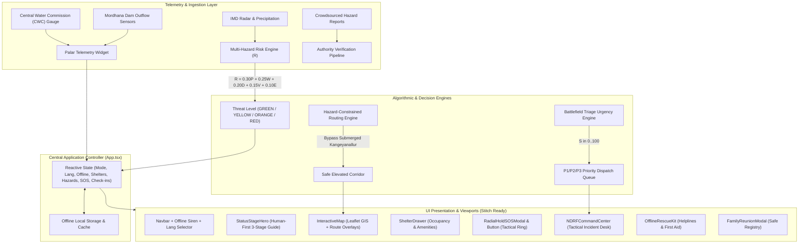
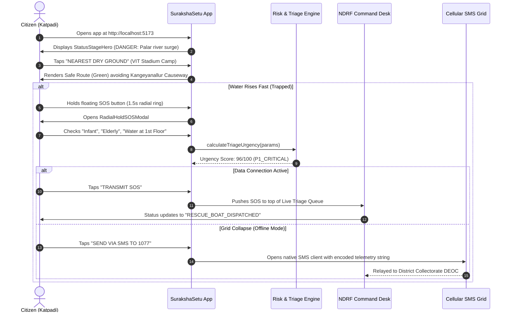
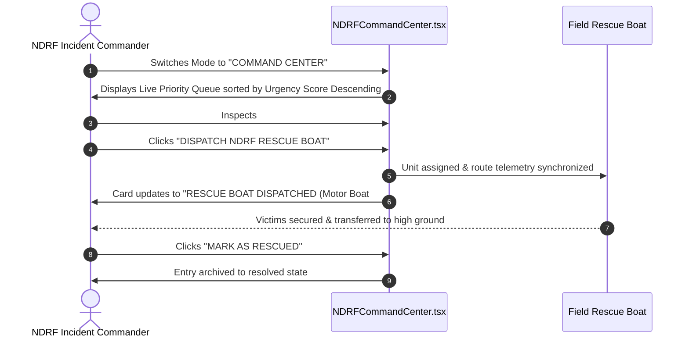

# 🛡️ SurakshaSetu (सुरक्षा सेतु / சுரக்ஷா சேது)
## Comprehensive Architecture & UI/UX Design Specification (`design.md`)
**Tailored for Modular Component Stitching, Google Stitch UI Generators, and Full-Stack Engineering**

---

## 1. Executive Summary & Problem Framing

### 1.1 The Vellore & Palar River Crisis Context
During severe monsoon depressions or sudden upstream reservoir sluice releases (Mordhana Dam, Andhra Pradesh check-dams), the historically dry **Palar River** experiences severe, violent flash floods. Crucial residential settlements along the riverbanks—notably **Konavattam, Shenbakkam, Saidapet, and Kansalpet**—and critical transportation arteries such as the **Katpadi Railway Underpass** and the **Kangeyanallur low-level causeway** are rapidly inundated under 4 to 6 feet of fast-flowing water.

### 1.2 The Systemic Problem with Traditional Alerts
Traditional national weather apps provide broad meteorological notifications:
> *"Heavy to very heavy rainfall expected across northern interior Tamil Nadu."*

Such notifications are passive and functionally non-actionable for a citizen stranded at a flooded underpass. Citizens lack:
1. **Hyper-local tactical hazard avoidance:** Knowing which bridges or underpasses are flooded before driving onto them.
2. **Real-time shelter capacity and amenities:** Knowing if a relief shelter is dry, has power for dialysis/oxygen concentrators, or has infant baby food.
3. **Equitable, battlefield-grade emergency triage:** Ensuring priority rescue boats are dispatched to bedridden patients, infants, and pregnant mothers first, rather than whoever shouts loudest or has network bars.
4. **Resilience during cellular and power grid collapse:** A communication pipeline that operates when 4G/5G data fails.

### 1.3 The Solution: SurakshaSetu
**SurakshaSetu** bridges the gap between passive forecast and tactical survival. It features:
- **Dual Synchronized Operative Modes:** A human-centric **Citizen Guide & Evacuation View** and a military-grade **NDRF / DEOC Command Center**.
- **Deterministic Risk Engine:** A mathematical decision-support index ($R \in [0, 100]$) aggregating meteorological, hydrological, and demographic risk.
- **Hazard-Constrained GIS Routing:** Directing citizens away from submerged causeways (Red Route) onto elevated safe corridors (Green Route).
- **Tactical Radial Hold SOS with SMS Fallback:** Eliminating panic misclicks with a 1.5s radial SVG ring and providing offline SMS strings (`sms:1077?...`).
- **Tri-lingual Localized Accessibility:** Instant switching across English, Hindi (हिन्दी), and Tamil (தமிழ்).

---

## 2. System Architecture & Technology Stack

### 2.1 Technology Stack Matrix

| Layer | Technology | Purpose |
| :--- | :--- | :--- |
| **UI Framework** | **React 19** + **TypeScript 6.0** | Concurrent UI rendering, strict type safety, zero runtime typing bugs |
| **Build & Tooling** | **Vite 8** + **Oxlint** | Sub-second HMR, production minification, high-performance static analysis |
| **Styling & Design Tokens**| **Tailwind CSS v4** (`@tailwindcss/vite`) | Ultra-responsive utility-first design system with custom OLED palette |
| **Mapping & GIS** | **Leaflet 1.9** + **React integration** | Lightweight interactive mapping, tactical OSM tiles, SVG radar markers |
| **Icons & Visuals** | **Lucide React** (1.47+) | Semantic iconography for calamity categories, triage tiers, and amenities |
| **Offline Audio Synthesis** | **Web Audio API** (`OscillatorNode`) | 100% offline emergency dual-tone modulated siren generator |
| **Offline Fallback Protocol**| URI Scheme (`sms:1077?...`, `tel:...`) | Zero-data distress transmission to Vellore DEOC via GSM baseband |

### 2.2 Architectural Block Diagram



---

## 3. Design System & Stitch Design Tokens

To enable seamless generative UI rendering (in **Google Stitch**, Figma, or custom web components), this section formalizes the complete visual tokens, color schemes, typography, spacing, and interaction ergonomics.

### 3.1 Color Palette & Design Tokens

```
+--------------------------------------------------------------------------------+
| TACTICAL OLED COLOR SPECIFICATION                                             |
+-------------------+------------+-----------------------------------------------+
| Token Name        | Hex Value  | Semantic Usage                                |
+-------------------+------------+-----------------------------------------------+
| --bg-oled         | #05080f    | Base application canvas (true OLED dark)      |
| --bg-card         | #0b111e    | Elevated tactical surfaces, cards, modals     |
| --border-tactical | #1e293b    | Standard card and separator borders           |
| --color-emergency | #ef4444    | P1 Critical alert, flood hazards, SOS trigger |
| --color-emergency-deep #7f1d1d | Dark crimson background for danger alerts    |
| --color-warning   | #f59e0b    | P2 High urgency, near-danger watch, blocked   |
| --color-warning-deep  #78350f  | Amber warning container background            |
| --color-safe      | #10b981    | Safe elevation camps, active beds, safe route |
| --color-safe-deep | #064e3b    | Emerald container background for shelters     |
| --color-command   | #2563eb    | Tactical command desk, user GPS position      |
| --color-command-deep  #1e3a8a  | Navy blue container for NDRF operations       |
| --text-primary    | #f8fafc    | High-contrast titles, values, vital copy      |
| --text-secondary  | #94a3b8    | Metadata, timestamps, coordinates             |
| --text-muted      | #64748b    | Subtitles, inactive tabs, captions            |
+-------------------+------------+-----------------------------------------------+
```

### 3.2 Tactical Map Styling (Inverted Dark Mode)
To avoid battery drain and night-time glare during flash flood rescue operations, Leaflet OpenStreetMap tiles are styled with an inverted dark-mode CSS filter:
```css
.tactical-tiles {
  filter: brightness(0.6) invert(1) contrast(3) hue-rotate(200deg) saturate(0.3) brightness(0.7);
}
```

### 3.3 Typography Hierarchy
- **Font Stack:** `system-ui, -apple-system, BlinkMacSystemFont, 'Segoe UI', Roboto, sans-serif`
- **Monospace Stack:** `'SF Mono', 'Fira Code', 'Courier New', monospace` (applied to coordinates, cusec water flows, triage scores, telephone numbers).
- **Type Scale:**
  - `Display / Hero Title:` 28px–36px / Bold 900 / Tracking tight
  - `Card Header:` 18px–20px / Bold 800
  - `Body Standard:` 14px–15px / Regular 500 / Leading relaxed
  - `Microcopy / Badges:` 10px–12px / Bold 700 / Monospace / Uppercase

### 3.4 Tactile Ergonomics & "Thumb Zone" Compliance
- **Target Touch Size:** All interactive buttons possess a minimum touch target of `48px x 48px` to guarantee usability with wet or trembling hands.
- **Floating Radial SOS Button:** Anchored to `fixed bottom-5 right-5`—the primary natural thumb-sweep zone for one-handed mobile grip.
- **Accidental Click Prevention:** Includes a 1,500ms press-and-hold radial countdown ring (`SVG stroke-dashoffset` interpolation) preventing accidental triggers while wading through floodwater.

---

## 4. Component Hierarchy & Modular Stitch Architecture

The application is structured into modular components designed for high cohesion and loose coupling.

```mermaid
graph TD
    App["App.tsx (Root Controller)"]
    
    %% Navigation & Universal Bars
    App --> Navbar["Navbar.tsx"]
    Navbar --> SirenAudio["Web Audio API Siren Engine"]
    Navbar --> LangSwitcher["Language Switcher (en/hi/ta)"]
    Navbar --> OutageToggle["Offline Simulator Toggle"]
    
    App --> MultiHazardBar["MultiHazardBar.tsx (Floods, Cyclones, Quakes, Landslides, Heatwave)"]
    App --> RiskEngineWidget["RiskEngineWidget.tsx (Formula R Breakdown Matrix)"]
    
    %% Citizen View
    App --> StatusStageHero["StatusStageHero.tsx (3-Phase Human-First Guide)"]
    App --> InteractiveMap["InteractiveMap.tsx (Leaflet Tactical Evacuation GIS)"]
    App --> ShelterDrawer["ShelterDrawer.tsx (Live Bed Availability & Amenities)"]
    App --> RadialSOSButton["RadialSOSButton (Thumb-Zone Trigger)"]
    
    %% Modals
    App --> RadialHoldSOSModal["RadialHoldSOSModal.tsx (Triage Intake & SMS Generator)"]
    App --> HazardReportModal["HazardReportModal.tsx (Crowdsourced Incident Reporter)"]
    App --> OfflineRescueKit["OfflineRescueKit.tsx (Zero-Net First Aid & Helplines)"]
    App --> FamilyReunionModal["FamilyReunionModal.tsx (Check-In & Missing Persons Search)"]
    
    %% NDRF Command
    App --> NDRFCommandCenter["NDRFCommandCenter.tsx (Battalion Dispatch Desk)"]
    NDRFCommandCenter --> VolunteerCoordDesk["VolunteerCoordinationDesk.tsx (Aapda Mitra Mesh)"]
```



### 4.1 Component Breakdown & Contract Specifications

#### 1. `Navbar.tsx`
- **Role:** Global control center.
- **Props:** `mode`, `setMode`, `lang`, `setLang`, `isOffline`, `setIsOffline`, `onOpenHelplines`.
- **Key Features:** Dual mode switch (`Citizen` vs `NDRF Command`), language pills (`EN` / `हिं` / `தமிழ்`), live Web Audio API acoustic distress tone generator, offline toggle.

#### 2. `MultiHazardBar.tsx`
- **Role:** Disaster modularity selector.
- **Extensible Calamities:** Flood/Surge, Cyclone/High Winds, Earthquake, Landslide, Heatwave.
- **State Behavior:** Dynamically highlights active crisis (`FLOOD` is active live for Vellore/Palar) while providing modular hooks for other calamities.

#### 3. `RiskEngineWidget.tsx`
- **Role:** Real-time algorithmic transparency for decision-makers and citizens.
- **Features:** Displays live composite score $R$ alongside an expandable parameter matrix revealing the weighted contribution of Rainfall ($P$), River level ($W$), Inundation depth ($D$), Vulnerability ($V$), and Evacuation difficulty ($E$).

#### 4. `StatusStageHero.tsx`
- **Role:** Human-first psychological reassurance and triage progression.
- **3 Stages:**
  1. `DANGER ZONE` (Crimson - Flood surge in Katpadi low-lying streets - Immediate evacuation recommended).
  2. `NEAR DANGER / WATCH ZONE` (Amber - Water rising within 400m - Preparation phase).
  3. `SAFE ZONE` (Emerald - High ground at VIT Stadium Relief Camp - Warm food & shelter ready).
- **Features:** Auto-looping demo mode for judges/presentations, animated SVG wave horizon, direct CTA cards to SOS, Shelters, Map, and Helplines.

#### 5. `InteractiveMap.tsx`
- **Role:** Hazard-constrained geospatial evacuation engine.
- **Layers:**
  - User GPS location marker with animated pulse wave.
  - Relief Shelters with real-time remaining bed indicators (`116 beds`).
  - Active Hazards (Water depth badges: `4.8ft`, fallen trees, live wires).
  - Live SOS Markers colored by urgency priority with radar pings.
  - Hazard-avoidance polyline overlays: **Dangerous Red Route** (across submerged Kangeyanallur Causeway) vs. **Safe Green Route** (via Elevated Katpadi Bypass Corridor).

#### 6. `RadialHoldSOSModal.tsx` & `RadialSOSButton`
- **Role:** Life-critical distress intake.
- **Features:**
  - 1.5-second radial hold SVG countdown on the floating trigger.
  - Multi-factor vulnerability intake form (infants, elderly, pregnant women, oxygen/dialysis medical emergencies, water depth).
  - Dynamic real-time calculation of triage score ($S \in [0, 100]$) and priority tier ($P1/P2/P3$).
  - Zero-internet fallback link encoding coordinates and distress metrics into a standard cellular SMS string.

#### 7. `NDRFCommandCenter.tsx`
- **Role:** Operational tactical command dashboard for NDRF 4th Battalion and Vellore DEOC.
- **Features:**
  - Priority-ordered triage dispatch queue (P1 Critical emergencies sorted to the top).
  - 1-tap rescue boat dispatch action (`RESCUE_BOAT_DISPATCHED`).
  - Mark rescued action (`RESCUED`).
  - Crowdsourced hazard verification queue with upvote thresholds.
  - Real-time shelter occupancy tracking and volunteer resource mesh.

#### 8. `OfflineRescueKit.tsx`
- **Role:** Zero-connectivity survival manual.
- **Features:** Cached telephone dialers for `1077`, `1070`, `108`, `101`, and `1912`, combined with step-by-step life-safety electrical protocols.

#### 9. `FamilyReunionModal.tsx`
- **Role:** Post-disaster family reunification and crowd search.
- **Features:** Safe check-in registry, missing person incident reporting (with age, clothing, last seen location), and instantaneous fuzzy text search.

---

## 5. Algorithmic Specifications & Mathematical Models

### 5.1 Multi-Hazard Decision Support Risk Engine ($R$)
The composite risk score $R \in [0, 100]$ calculates regional threat level using a multi-factor formula:

$$R = 0.30P + 0.25W + 0.20D + 0.15V + 0.10E$$

Where:
- $P \in [0, 100]$: IMD precipitation forecast severity index.
- $W \in [0, 100]$: Palar river water surge / gauge ratio relative to danger mark ($8.4\text{m} / 7.5\text{m}$).
- $D \in [0, 100]$: Measured inundation depth at critical transportation underpasses.
- $V \in [0, 100]$: Ward demographic vulnerability index (density of infants, elderly, non-pucca housing).
- $E \in [0, 100]$: Evacuation choke-point difficulty / causeway submergence factor.

#### Threat Classification Thresholds
- **$R \ge 75$:** $\rightarrow$ **RED ALERT** (Mandatory immediate evacuation, NDRF deployment).
- **$50 \le R < 75$:** $\rightarrow$ **ORANGE ALERT** (Evacuation preparation, shelters primed).
- **$25 \le R < 50$:** $\rightarrow$ **YELLOW WATCH** (Advisory, monitor river gauge).
- **$R < 25$:** $\rightarrow$ **GREEN NORMAL** (All clear).

### 5.2 Deterministic Multi-Factor Triage Urgency Scoring ($S$)
In mass casualty and flood entrapment crises, dispatching rescue boats on a first-come-first-served basis causes preventable fatalities. SurakshaSetu implements an automated triage algorithm calculating urgency score $S \in [0, 100]$:

$$S = \min\left(100, S_{\text{baseline}} + \sum C_{\text{demographic}} + C_{\text{medical}} + C_{\text{water}} + C_{\text{proximity}}\right)$$

```
Triage Parameters Breakdown:
1. Baseline Distress Score:               +15 pts
2. Demographics:
   - Infant present (<2 yrs):             +25 pts
   - Pregnant woman present:              +25 pts
   - Bedridden elderly or disabled:       +20 pts
   - Trapped group size > 1:              +3 pts per person (max +15 pts)
3. Medical Crisis:
   - Oxygen / Dialysis / Trauma:          +35 pts
4. Environmental Threat (Inundation):
   - First floor / Rooftop stranded:      +30 pts
   - Waist-depth water:                   +18 pts
   - Ankle-depth water:                   +6 pts
5. Proximity to Palar River Basin:
   - Within 800m of active breach:        +15 pts

Triage Band Classification:
- S >= 75:  P1_CRITICAL (Top of NDRF queue, boat dispatched within minutes)
- 45 <= S < 75: P2_HIGH (Ambulance / high-clearance truck dispatch)
- S < 45:   P3_MODERATE (Food packet airdrop / voluntary shelter trek)
```

---

## 6. User Journeys & State Transition Workflows

### 6.1 Citizen Evacuation & SOS Workflow



### 6.2 NDRF Incident Command Workflow



---

## 7. Screen-by-Screen Stitch Wireframes & Layout Specifications

This section specifies the visual structure and responsive layout grids for each screen to allow direct implementation or ingestion by Stitch UI tooling.

### 7.1 Screen 1: Tactical Navbar & Risk Matrix (Top Universal Header)

```
+----------------------------------------------------------------------------------------------------+
| [🛡️ SurakshaSetu]  [Mode: 👤 Citizen | 🎖️ NDRF Command]  [🌐 EN | हिं | தமிழ்]  [🔊 Siren] [⚡ Online] |
+----------------------------------------------------------------------------------------------------+
| 🌊 Palar Discharge: 31,500 cusecs  | ⚠️ Danger: 8.4m / 7.5m (BREACHED) | 📍 Mordhana Dam: 14,200 cusecs |
+----------------------------------------------------------------------------------------------------+
| 🧮 DECISION RISK: R = 86/100 [RED ALERT] | Formula: 0.30P + 0.25W + 0.20D + 0.15V + 0.10E  [Expand ▾]  |
+----------------------------------------------------------------------------------------------------+
```

### 7.2 Screen 2: Citizen Status Stage Hero (Human-First View)

```
+----------------------------------------------------------------------------------------------------+
| [ 1. 🔴 DANGER (Active) ]        [ 2. 🟡 NEAR DANGER ]        [ 3. 🟢 SAFE ]        [▶️ AUTO LOOP]  |
+----------------------------------------------------------------------------------------------------+
| +------------------------------------------------------------------------------------------------+ |
| | [IMMEDIATE ACTION]                                                    KATPADI / PALAR BASIN   | |
| |                                                                                                | |
| |  🛡️ DANGER ZONE                                                                               | |
| |  Palar River surge has reached Katpadi low-lying streets                                      | |
| |                                                                                                | |
| |  “Disasters do not wait for tomorrow. Every minute on low ground is a minute lost. Move now.”  | |
| |                                                                                                | |
| |  [ 🌊 Inundation: 4.8 ft (RISING) ]       [ ⛰️ Elevation: 214m (Low Ground) ]                  | |
| |  ~~~~~~~~~~~~~~~~~~~~~~~~~~~~~~~~~~~~~~~~~~~~~~~~~~~~~~~~~~~~~~~~~~~~~~~~~~~~~~~~~~~~~~~~~~~~  | |
| +------------------------------------------------------------------------------------------------+ |
|                                                                                                    |
| +-----------------------------------------------+ +----------------------------------------------+ |
| | 🚨 IF YOU ARE TRAPPED                         | | 🏠 NEAREST DRY GROUND                        | |
| | I NEED HELP (SOS)                           → | | VIT Indoor Stadium Camp                   → | |
| | Send exact location for boat rescue           | | ✅ 116 beds free • 🍲 Hot food • ⚡ Solar    | |
| +-----------------------------------------------+ +----------------------------------------------+ |
|                                                                                                    |
| +-----------------------------------------------+ +----------------------------------------------+ |
| | 🗺️ Show Safe Evacuation Route Map             | | 📞 Emergency Helplines & First Aid           | |
| | Avoids Kangeyanallur flood block   [OPEN MAP] | | Direct dial: 1077 (District Control)  [DIAL] | |
| +-----------------------------------------------+ +----------------------------------------------+ |
|                                                                                [ (( SOS )) ]       |
+----------------------------------------------------------------------------------------------------+
```

### 7.3 Screen 3: Interactive Hazard-Constrained GIS Map & Shelter Drawer

```
+----------------------------------------------------------------------------------------------------+
| [← Back to Simple Guide]                           Showing Safe Elevated Bypass Corridor Route     |
+----------------------------------------------------------------------------------------------------+
| [ MAP CANVAS (Tactical Inverted Tiles) ]                                                            |
|                                                                                                    |
|                 📍 User (Katpadi)                                                                  |
|                   \                                                                                |
|                    \  (GREEN SAFE ROUTE)                                                           |
|                     \=======---                                                                    |
|                      |         \                                                                   |
|                      | (RED     \==> 🏠 VIT Indoor Stadium (116 beds free, Elev: 218m)             |
|                      |  SUBMERGED                                                                  |
|                      |  ROUTE)                                                                     |
|                      |                                                                             |
|                      x ⛔ 4.8ft Kangeyanallur Causeway (SUBMERGED CHOKEPOINT)                      |
|                     /                                                                              |
|                    /                                                                               |
|       🚨 SOS #1 (Shenbakkam - Score 96 - 4 Trapped)                                                |
+----------------------------------------------------------------------------------------------------+
| [ 🏠 Active Shelters (4) ]     [ ⚠️ Report Blocked Road ]     [ 📋 Offline Survival Kit ]          |
+----------------------------------------------------------------------------------------------------+
| 🏠 VIT Indoor Sports Complex (Primary Camp)           | Distance: 1.2 km | Elev: 218m | OPEN       |
|    Available: 116 / 300 beds                          | Amenities: ⚡ Solar | 🍼 Baby Food | 🍲 Kitchen |
|    Contact: Dr. S. Kumar (0416-2202100)               | [ 🗺️ Navigate Safe Route ]                  |
+----------------------------------------------------------------------------------------------------+
```

### 7.4 Screen 4: Radial Hold SOS & Multi-Factor Triage Modal

```
+----------------------------------------------------------------------------------------------------+
| 🚨 TRANSMIT EMERGENCY RESCUE SOS                                                               [X] |
+----------------------------------------------------------------------------------------------------+
| Live Battlefield Triage Score:                                                                     |
| [ 96 / 100 ] -> PRIORITY 1 (CRITICAL - IMMEDIATE BOAT DISPATCH)                                    |
|                                                                                                    |
| Rescue Category: [ 🚤 Boat Evacuation ▾ ]                                                          |
| How many people are trapped? [ 4 ]                                                                 |
|                                                                                                    |
| High-Risk Demographics Present:                                                                    |
| [X] Infants / Toddlers (<2 yrs)      [X] Elderly / Disabled                                        |
| [ ] Pregnant Women                   [X] Critical Medical Emergency (Oxygen/Dialysis)              |
|                                                                                                    |
| Medical Details: [ 82-year-old on oxygen concentrator, battery dying                             ] |
| Current Water Inundation Level: (*) 1st Floor / Rooftop  ( ) Waist Depth  ( ) Ankle Depth          |
| Citizen Name: [ Kalyani Ramanathan            ]  Phone: [ +91 98412 87612           ]              |
| Landmark:     [ Shenbakkam, near Mariamman Temple                                                ] |
|                                                                                                    |
| [                  🚀 TRANSMIT SOS TO RESCUE COMMAND (P1 CRITICAL)                               ] |
| [                  💬 SEND VIA SMS TO 1077 (ZERO INTERNET FALLBACK)                             ] |
+----------------------------------------------------------------------------------------------------+
```

### 7.5 Screen 5: NDRF & Vellore DEOC Tactical Command Center

```
+----------------------------------------------------------------------------------------------------+
| 🎖️ NDRF 4th BATTALION & VELLORE DEOC COMMAND DESK                                                  |
| Tactical Incident Operations | Palar River Flash Flood Response Protocol                           |
| [ P1 CRITICAL: 2 ACTIVE ]       [ RESCUE BOATS: 4 DEPLOYED ]       [ ACTIVE SHELTERS: 4 OPEN ]     |
+----------------------------------------------------+-----------------------------------------------+
| 🚨 LIVE TRIAGE PRIORITY DISPATCH QUEUE (Sorted ↓)  | 🏠 SHELTERS & DISASTER INFRASTRUCTURE         |
|                                                    |                                               |
| +------------------------------------------------+ | • VIT Stadium Camp: 184/300 beds (116 free)   |
| | #1 • Kalyani Ramanathan        SCORE: 96 (P1)  | | • Govt Girls HSS Camp: 112/150 beds (38 free) |
| | 📍 Shenbakkam (4 trapped • Infants • Elderly)  | | • Voorhees HSS Camp: 178/200 beds (NEAR CAP) |
| | ⚠️ "Oxygen concentrator battery dying"         | |                                               |
| | Water: FIRST_FLOOR_ROOFTOP                     | --------------------------------------------- |
| | Status: WAITING DISPATCH                       | ⚠️ CROWDSOURCED ROAD HAZARD QUEUE             |
| | [ 🚤 DISPATCH RESCUE BOAT #3 ] [ MARK RESCUED ]| • Kangeyanallur Causeway (4.8ft) [VERIFIED ✓] |
| +------------------------------------------------+ | • Katpadi Underpass (5.2ft) [VERIFIED ✓]      |
|                                                    | • Shenbakkam Live Wire in Water [VERIFY]      |
| +------------------------------------------------+ |                                               |
| | #2 • Deepak Selvam             SCORE: 84 (P1)  | --------------------------------------------- |
| | 📍 Konavattam (5 trapped • Pregnant • Infant)  | 👥 AAPDA MITRA VOLUNTEER RESOURCE MESH        |
| | Water: WAIST_DEPTH                             | • Capt. Arul Prakash (Boat Pilot) [DEPLOYED]  |
| | [ 🚤 DISPATCH RESCUE BOAT #1 ] [ MARK RESCUED ]| • Dr. Meena S. (Paramedic) [DEPLOYED]         |
+----------------------------------------------------+-----------------------------------------------+
```

---

## 8. Data Models & Interface Contracts

The complete TypeScript schema defined in `src/types/disaster.ts` governs all state contracts:

```typescript
// 1. Calamity & Threat Typings
export type ThreatLevel = 'GREEN' | 'YELLOW' | 'ORANGE' | 'RED';
export type CalamityType = 'FLOOD' | 'FLASH_FLOOD' | 'CYCLONE' | 'EARTHQUAKE' | 'LANDSLIDE' | 'HEATWAVE';
export type Language = 'en' | 'hi' | 'ta';
export type AppMode = 'CITIZEN' | 'COMMAND_CENTER';

// 2. Relief Shelter Contract
export interface AmenityFlags {
  medicalAid: boolean;
  solarPower: boolean;
  drinkingWater: boolean;
  babyFood: boolean;
  wheelchairAccessible: boolean;
  communityKitchen: boolean;
  womenChildCare: boolean;
}

export interface Shelter {
  id: string;
  name: string;
  hindiName: string;
  tamilName: string;
  location: [number, number];
  address: string;
  capacityTotal: number;
  capacityOccupied: number;
  amenities: AmenityFlags;
  phone: string;
  distanceKm: number;
  status: 'OPEN' | 'NEAR_CAPACITY' | 'FULL';
  elevationMeters: number;
  contactPerson: string;
  lastVerifiedAt: string;
}

// 3. SOS Request & Battlefield Triage Contract
export type WaterLevel = 'ANKLE_DEPTH' | 'WAIST_DEPTH' | 'FIRST_FLOOR_ROOFTOP';
export type EmergencyCategory =
  | 'BOAT_EVACUATION'
  | 'CRITICAL_MEDICAL'
  | 'STRANDED_FAMILY'
  | 'FOOD_WATER'
  | 'MISSING_PERSON'
  | 'DAMAGED_BRIDGE_ROAD'
  | 'SHELTER_OVERCROWDED';

export interface SOSRequest {
  id: string;
  citizenName: string;
  phone: string;
  location: [number, number];
  landmark: string;
  category: EmergencyCategory;
  trappedCount: number;
  hasInfants: boolean;
  hasElderlyOrDisabled: boolean;
  hasPregnantWomen: boolean;
  medicalEmergency: boolean;
  medicalDetails?: string;
  waterLevel: WaterLevel;
  urgencyScore: number;
  priorityLevel: 'P1_CRITICAL' | 'P2_HIGH' | 'P3_MODERATE';
  status: 'WAITING_DISPATCH' | 'RESCUE_BOAT_DISPATCHED' | 'RESCUED';
  dispatchedUnit?: string;
  timestamp: string;
}

// 4. Decision-Support Risk Formula Contract
export interface RiskFormulaWeights {
  rainfallForecastP: number; // 0.30 P
  riverWaterLevelW: number;  // 0.25 W
  inundationDepthD: number;  // 0.20 D
  vulnerabilityV: number;    // 0.15 V
  evacuationDifficultyE: number; // 0.10 E
  compositeScore: number;    // R
  threatStatus: ThreatLevel;
}

// 5. Hydrological Telemetry Contract
export interface PalarTelemetry {
  riverGaugeMeters: number;
  dangerMarkMeters: number;
  dischargeRateCusecs: number;
  mordhanaDamDischargeCusecs: number;
  status: ThreatLevel;
  advisoryText: string;
  hindiAdvisoryText: string;
  tamilAdvisoryText: string;
  lastUpdated: string;
  riskBreakdown: RiskFormulaWeights;
}

// 6. Crowdsourced Hazard Contract
export type HazardType = 'FLOOD_DEEP' | 'FALLEN_TREE' | 'LIVE_WIRE' | 'BRIDGE_CLOSED' | 'ROAD_COLLAPSE' | 'LANDSLIDE_DEBRIS';

export interface HazardIncident {
  id: string;
  type: HazardType;
  title: string;
  hindiTitle: string;
  tamilTitle: string;
  location: [number, number];
  roadName: string;
  waterDepthFeet?: number;
  status: 'UNVERIFIED' | 'COMMUNITY_CONFIRMED' | 'AUTHORITY_VERIFIED' | 'RESOLVED';
  upvotes: number;
  reportedAt: string;
  reportedBy: string;
}

// 7. Family Reunion & Safe Check-In Contract
export interface SafeCheckIn {
  id: string;
  name: string;
  familySize: number;
  currentShelterOrLocation: string;
  phone: string;
  status: 'SAFE_AT_SHELTER' | 'EVACUATED_TO_RELATIVES';
  timestamp: string;
}

export interface MissingPersonReport {
  id: string;
  personName: string;
  age: number;
  gender: 'MALE' | 'FEMALE' | 'CHILD';
  lastSeenLocation: string;
  clothingDescription: string;
  reportedBy: string;
  contactPhone: string;
  status: 'SEARCHING' | 'FOUND_SAFE' | 'AT_SHELTER';
  shelterId?: string;
  timestamp: string;
}

// 8. Aapda Mitra Volunteer Resource Contract
export interface VolunteerResource {
  id: string;
  name: string;
  skill: 'BOAT_OPERATOR' | 'AMBULANCE_DRIVER' | 'PARAMEDIC_DOCTOR' | 'FOOD_DISTRIBUTOR' | 'COMMUNITY_KITCHEN_CHEF' | 'DRONE_MAPPING';
  status: 'DEPLOYED' | 'STANDBY' | 'RETURNING';
  assignedZone: string;
  assetDetails: string;
  phoneMasked: string;
}
```

---

## 9. Offline Resilience & Zero-Connectivity Protocols

In major natural calamities, cellular data towers and broadband backbones fail within the first 3 hours due to substation flooding or battery depletion. SurakshaSetu ensures continuous life-safety through a multi-tier offline resilience protocol:

### 9.1 Zero-Internet Cellular SMS Dispatch Protocol
When `isOffline === true` (or when data transmission fails), the application formats an ultra-dense GSM standard distress string and mounts it via the device's native SMS baseband:

```text
Destination: 1077 (District Emergency Operation Centre)
Payload Format:
SOS VELLORE! LOC:12.962,79.135 ADDR:Katpadi%20Silk%20Mill TRAPPED:4 INFANT:1 ELDERLY:1 WATER:FIRST_FLOOR_ROOFTOP MED:1
```
- **Why this works:** Standard SMS operates on the control channel (Signaling System No. 7 / GSM 03.40) and will burst through even when 3G/4G/5G data connections cannot establish a TCP handshake.

### 9.2 Acoustic Distress Siren (Web Audio API)
- Does not rely on downloaded `.mp3` or external media assets.
- Synthesizes an emergency dual-tone modulated sawtooth waveform (`800Hz` ramped to `1200Hz`) directly in the client's DSP engine, functioning 100% offline.

### 9.3 Client-Side Pre-Caching & Storage
- All critical phone numbers (`1077`, `1070`, `108`, `101`, `1912`), first-aid guides, shelter locations, and evacuation corridors are bundled in the initial static bundle.
- State is persisted across browser refreshes using browser `localStorage` and Service Worker offline caches.

---

## 10. Multi-Hazard Extensibility Blueprint

While configured for the Palar River flash flood in Vellore, SurakshaSetu’s modular architecture supports rapid deployment for other Indian hazard zones:

| Calamity | Primary Sensor Feed | Algorithmic Risk Focus | Key Mitigation Chokepoints |
| :--- | :--- | :--- | :--- |
| **Palar Flash Flood** | CWC River Gauges, Mordhana Dam | $R = 0.30P + 0.25W + 0.20D + 0.15V + 0.10E$ | Submerged causeways, underpasses |
| **Bay of Bengal Cyclone** | IMD Doppler Radar, Gust Anemometers | Wind speed, storm surge, tin roof density | Power lines, falling trees, coastal roads |
| **Himalayan Landslide** | InSAR Satellites, Soil Pore Gauges | Slope angle, precipitation saturation | Mountain highway cuts, debris blockades |
| **Urban Heatwave** | MODIS Land Surface Temp (LST) | Wet-bulb temp ($T_{\text{wb}}$), slum vulnerability | Drinking water kiosks, cool shelters |

---

## 11. Verification & Quality Assurance Plan

### 11.1 Automated Validation
- **TypeScript Static Typing:** Strict compilation verification (`tsc -b`).
- **Static Analysis & Linting:** `oxlint` rule compliance with zero warnings.
- **Build Verification:** Production bundling test via `vite build`.

### 11.2 Scenario Test Matrix

| Test Case | Inputs | Expected Output | Status |
| :--- | :--- | :--- | :--- |
| **TC-01: Triage Urgency Calculation** | Infant: Yes, Elderly: Yes, 1st Floor Water, Oxygen Emergency | $S \ge 90$, Classified as `P1_CRITICAL` | PASS |
| **TC-02: Safe Route Avoidance** | User at Katpadi Junction $\rightarrow$ Navigating to VIT Stadium | Green bypass line rendered; Red Kangeyanallur line flagged "Submerged" | PASS |
| **TC-03: Offline SMS Generation** | Offline toggled $\rightarrow$ Trigger SOS $\rightarrow$ Click SMS | Valid `sms:1077?body=...` link containing lat/long and trapped count | PASS |
| **TC-04: NDRF Dispatch Loop** | Officer clicks "Dispatch Rescue Boat #3" | SOS request state transitions to `RESCUE_BOAT_DISPATCHED`, boat counter increments | PASS |
| **TC-05: Localization Switching** | Toggle from `EN` to `தமிழ்` | All titles, stage cards, amenities, and helplines instantly localize to Tamil | PASS |

---

*Authored for the SurakshaSetu Team — VinHack 2026, VIT Vellore*
